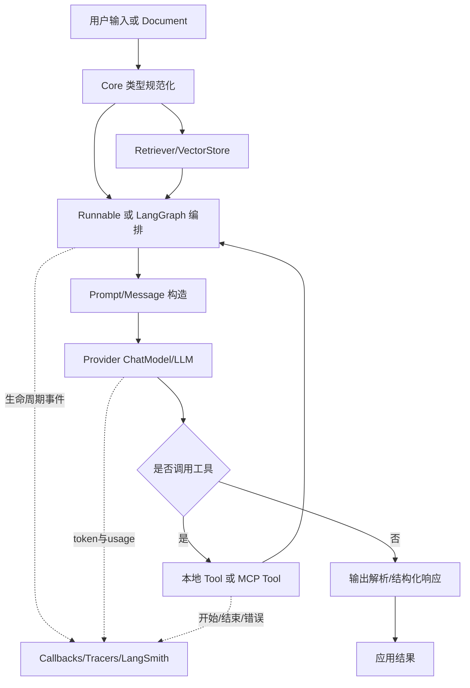
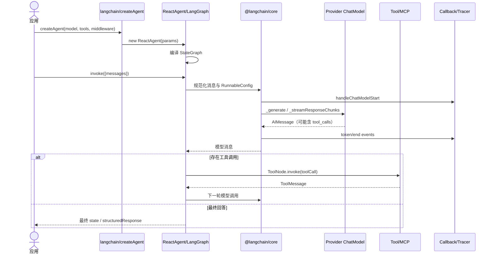

# 01. 项目整体架构

## 定位

LangChain.js 不是单体库，而是按“协议、编排、兼容、集成、工程工具”拆分的 monorepo。根配置声明 `libs/*`、`libs/providers/*`、`examples` 和 `internal/*` 为工作区，Turborepo 根据包依赖顺序构建。

## 分层

| 层 | 包/目录 | 主要职责 | 依赖原则 |
| --- | --- | --- | --- |
| 协议层 | `@langchain/core` | Runnable、消息、模型、Prompt、Tool、Retriever、VectorStore、回调、序列化 | 不依赖具体 provider |
| 现代编排层 | `langchain` | `createAgent`、`ReactAgent`、中间件、通用模型初始化、Hub、存储 | 依赖 Core 与 LangGraph |
| 兼容层 | `@langchain/classic` | 传统 Chain、AgentExecutor、Memory、高级 Retriever、实验模块 | 依赖 Core，部分能力依赖 OpenAI/Textsplitters |
| 数据处理层 | `@langchain/textsplitters` | 字符、递归、Token 等文本切分 | Core 为 peer dependency |
| 协议桥接层 | `@langchain/mcp-adapters` | MCP 连接、工具发现、资源/Prompt 访问、Tool 转换 | Core + LangGraph + MCP SDK |
| 集成层 | `@langchain/*` providers | 模型、Embedding、VectorStore、Tool、Cache 等具体实现 | 通常只依赖 Core 和外部 SDK |
| 工程层 | `internal/*` | 构建插件、共享 tsconfig、标准测试、模型 profile | 不作为普通应用入口 |

## 顶层数据流

## 一次现代 Agent 请求的跨包时序

## 包边界为什么这样划分

1. **Core 保持 provider 无关。** 自定义模型只需继承 `BaseChatModel`，自定义检索器只需实现 `_getRelevantDocuments`，上层编排无需知道供应商 SDK。
2. **集成独立发布。** OpenAI、Anthropic、Redis、Pinecone 等包可独立升级，避免主包绑定全部可选依赖。
3. **现代与 Classic 分离。** 新 Agent 采用 LangGraph；传统 Chain、Memory 与 AgentExecutor 保留在独立包，降低主包公共面的复杂度。
4. **Runnable 统一组合。** Prompt、模型、解析器、Retriever 都能进入相同的 `invoke/batch/stream` 管道。

## 目录职责

| 路径 | 内容 |
| --- | --- |
| `libs/langchain-core/src` | 纯抽象、数据类型、运行时通用设施 |
| `libs/langchain/src/agents` | 新版 Agent 状态图、节点、中间件、stream transformer |
| `libs/langchain-classic/src` | 旧式链式编排与高级组件 |
| `libs/providers` | 30 个独立 provider 包 |
| `internal/build` | `tsdown` 配置与 import-map/CJS/secret 插件 |
| `internal/standard-tests` | provider 能力一致性测试基类 |
| `environment_tests` | ESM/CJS/Bun/Cloudflare/Vite 等导出兼容验证 |
| `dependency_range_tests` | 支持依赖版本范围的容器化验证 |
| `examples` | 可构建示例，不属于核心发布入口 |

## 稳定扩展点

- 计算单元：继承/包装 [`Runnable`](../../libs/langchain-core/src/runnables/base.ts)。
- 模型：继承 [`BaseChatModel`](../../libs/langchain-core/src/language_models/chat_models.ts) 并实现 `_llmType`、`_generate`，可选实现 streaming 与 `bindTools`。
- Tool：使用 `tool()`，或继承 [`StructuredTool`](../../libs/langchain-core/src/tools/index.ts)。
- Retriever：继承 [`BaseRetriever`](../../libs/langchain-core/src/retrievers/index.ts)。
- VectorStore：继承 [`VectorStore`](../../libs/langchain-core/src/vectorstores.ts)。
- Agent 行为：使用 [`createMiddleware`](../../libs/langchain/src/agents/middleware.ts) 注册生命周期 hook。
- Provider：用 [`create-langchain-integration`](../../libs/create-langchain-integration) 创建符合仓库约定的独立包。

## 变更影响原则

- 修改 Core 公共类型会影响几乎所有包，应运行全量单测与导出测试。
- 修改 `langchain/src/agents` 主要影响现代 Agent 与 LangGraph 交互，应重点运行 agent、middleware、stream 测试。
- 修改单一 provider 通常只需该包测试与 standard tests，但 Core peer 版本必须兼容。
- Classic 变更不应让现代主包重新依赖旧式实现。

