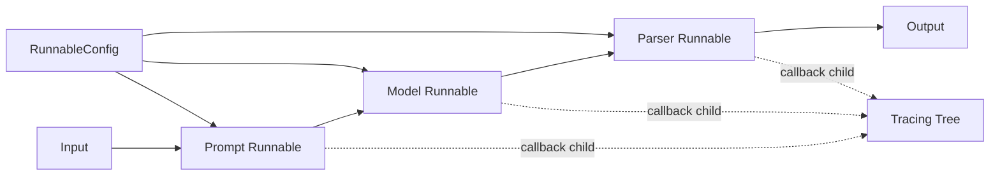
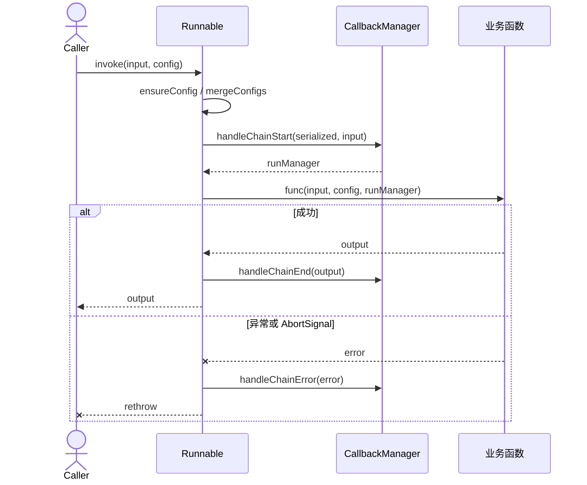
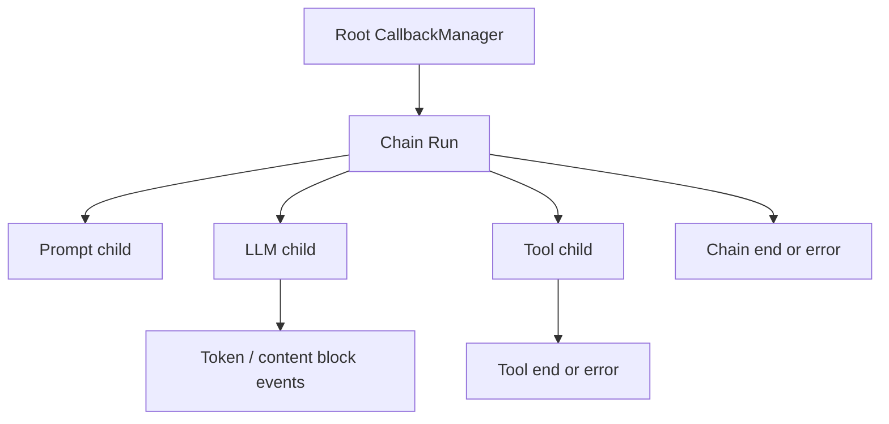
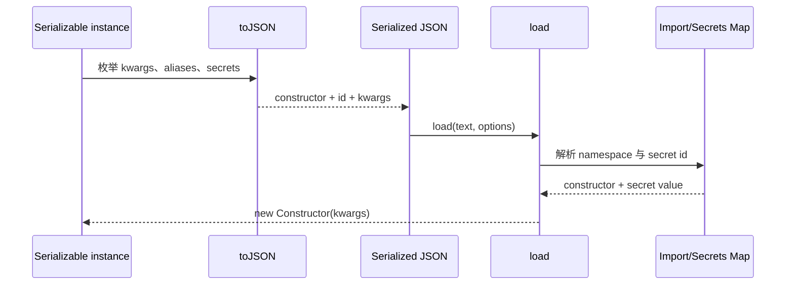

# 02. Core 运行时：Runnable、配置、回调与序列化

## 模块职责

`@langchain/core` 是仓库的最底层稳定协议。它不负责选择具体模型或数据库，而是规定组件如何执行、组合、跟踪、序列化和传播配置。

主要源码：

- [`runnables/base.ts`](../../libs/langchain-core/src/runnables/base.ts)：Runnable 基类及 Sequence、Lambda、Binding、Fallback。
- [`runnables/config.ts`](../../libs/langchain-core/src/runnables/config.ts)：`RunnableConfig` 合并、上下文与回调提取。
- [`callbacks/manager.ts`](../../libs/langchain-core/src/callbacks/manager.ts)：各运行类型的生命周期管理器。
- [`load/serializable.ts`](../../libs/langchain-core/src/load/serializable.ts)：可序列化对象与 secret/alias 规则。
- [`load/index.ts`](../../libs/langchain-core/src/load/index.ts)：从 JSON 构造对象。

## Runnable 协议

`Runnable<Input, Output, CallOptions>` 是抽象工作单元，唯一必须实现的是 `invoke()`。基类提供：

| 方法 | 语义 | 默认实现 |
| --- | --- | --- |
| `invoke(input, config)` | 单次执行 | 子类实现 |
| `batch(inputs, configs)` | 并发批处理 | 通过 `AsyncCaller` 多次调用 `invoke` |
| `stream(input, config)` | 流式输出 | 默认只 yield 一次 `invoke` 结果 |
| `pipe(next)` | 串联两个 Runnable | 生成 `RunnableSequence` |
| `withConfig(config)` | 绑定默认配置 | 生成 `RunnableBinding` |
| `withRetry(fields)` | 失败重试 | 生成 `RunnableRetry` |
| `withFallbacks(list)` | 主路径失败后降级 | 生成 `RunnableWithFallbacks` |
| `pick/assign` | 选择或扩展对象字段 | 组合投影 Runnable |
| `streamEvents` | 输出标准生命周期事件 | 通过回调流实现 |

### 组合流程图

`RunnableSequence.invoke` 逐步调用组件，并为每一步派生 `seq:step:N` 子回调；streaming 版本用转换流把上游 chunk 传给下游，因此组合对象本身仍保持统一协议。

### 调用时序

## RunnableConfig

配置沿调用树传播，常用字段包括：

| 字段 | 用途 |
| --- | --- |
| `callbacks` | 生命周期观察器与 tracer |
| `tags` / `metadata` | 运行标识、LangSmith 过滤与关联信息 |
| `runName` / `runId` | 显式命名和追踪 ID |
| `maxConcurrency` | batch 并发上限 |
| `recursionLimit` | 图或递归编排保护 |
| `signal` / `timeout` | 取消与超时 |
| `configurable` | 运行时可配置字段 |

`ensureConfig()` 负责补齐配置，`mergeConfigs()` 负责合并多层配置。实现组件时应把 Runnable 配置与 provider 调用参数分离，避免把 callbacks、tags 等字段直接传给 SDK。

## 回调体系

`CallbackManager` 根据运行类型创建专用 run manager：

| Manager | 主要事件 |
| --- | --- |
| `CallbackManagerForLLMRun` | new token、chat stream event、LLM end/error |
| `CallbackManagerForChainRun` | chain end/error、agent action/end |
| `CallbackManagerForToolRun` | tool event/end/error |
| `CallbackManagerForRetrieverRun` | retriever end/error |

父 manager 的 `getChild()` 形成追踪树。Runnable、模型、工具和 Retriever 都遵循“start -> events -> end/error”，LangSmith tracer 只是该协议的一种 handler。

## 序列化与加载

`Serializable` 通过以下静态/实例信息描述对象：

- `lc_namespace`：类型命名空间。
- `lc_serializable`：是否允许序列化为构造器描述。
- `lc_secrets`：字段到 secret ID 的映射，防止密钥明文进入 JSON。
- `lc_aliases`：TypeScript 字段名与序列化字段名映射。
- `lc_attributes`：附加序列化属性。

`toJSON()` 输出构造器、not implemented 或 secret reference。`load()` 解析 JSON，利用 import map 找到构造器，并通过 `secretsMap`/环境变量注入密钥。

## 关键实现类

| 类 | 责任 |
| --- | --- |
| `RunnableSequence` | 有序串联多个 Runnable，传播子配置与 stream |
| `RunnableLambda` | 将普通函数/异步生成器适配成 Runnable |
| `RunnableBinding` | 在不改变原对象的情况下绑定 kwargs/config |
| `RunnableMap` | 并行计算多个具名分支 |
| `RunnableWithFallbacks` | 捕获指定异常并依次尝试备选 Runnable |
| `RunnableEach` | 对输入集合应用相同 Runnable |
| `RunnableRetry` | 按策略重试，并保留追踪语义 |

## 扩展约束

- 子类实现 `invoke` 时优先使用 `_callWithConfig`，保证 start/end/error 事件完整。
- 支持真实流式能力的组件应覆写 `_streamIterator`，否则 `stream()` 只是单块结果。
- 批量 API 能由供应商原生 batch 优化时可覆写 `batch`，否则遵循 `maxConcurrency`。
- 配置必须继续向子 Runnable 传播，且子调用使用 `runManager.getChild()`。
- 密钥字段应进入 `lc_secrets`，不能被普通 `toJSON()` 展开。

