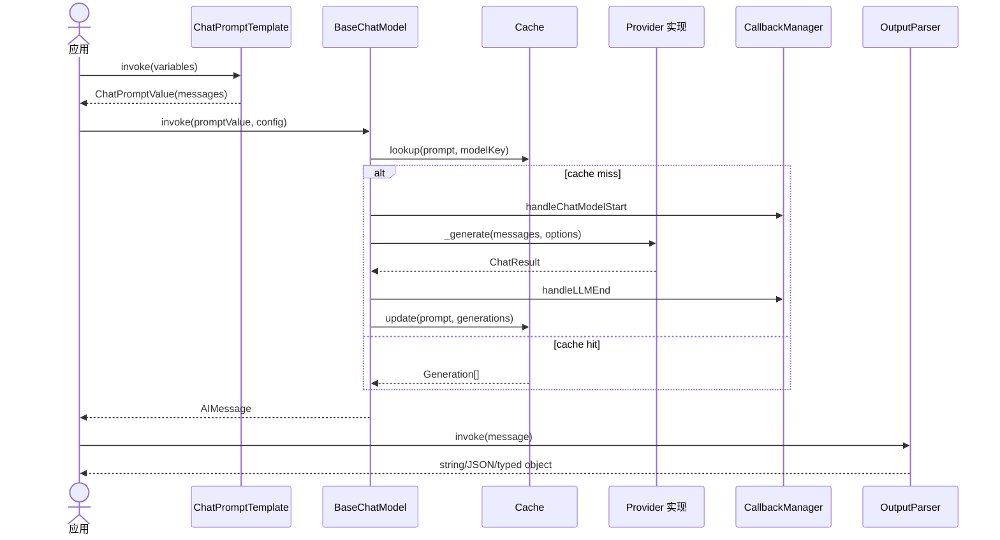
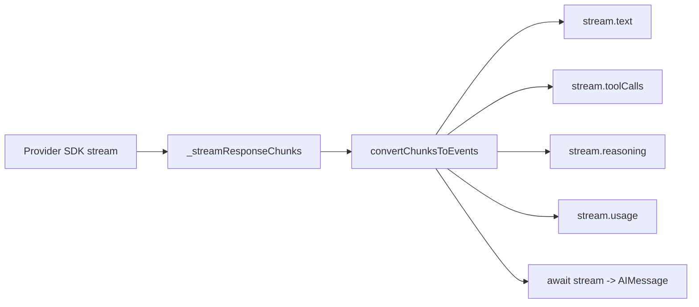

# 03. 消息、Prompt、模型与输出解析

## 模块职责

该调用栈把应用输入转换为 provider 可接受的消息，执行模型调用，再将 generation 转为消息或结构化结果。所有主要对象都是 Runnable，因此可以用 `.pipe()` 组合。

## 消息模型

[`messages`](../../libs/langchain-core/src/messages) 定义统一消息类型：

| 类型 | 语义 | 关键字段 |
| --- | --- | --- |
| `HumanMessage` | 用户输入 | `content`、`name`、metadata |
| `AIMessage` | 模型完整输出 | `tool_calls`、`usage_metadata`、`response_metadata` |
| `SystemMessage` | 系统级指令 | `content` |
| `ToolMessage` | 工具调用结果 | `tool_call_id`、`artifact`、`status` |
| `*MessageChunk` | 流式增量 | 可通过 `concat` 合并 |

`coerceMessageLikeToMessage()` 接受实例、角色元组或 `{ role, content }` 对象。消息 content 可以是字符串，也可以是标准 content blocks；`block_translators` 负责 OpenAI、Anthropic、Google、Bedrock 等 provider 格式之间的转换。

消息工具包括 `filterMessages`、`mergeMessageRuns` 和 `trimMessages`，用于 Agent 上下文清理。

## Prompt

[`BasePromptTemplate`](../../libs/langchain-core/src/prompts/base.ts) 负责输入变量校验、partial 变量合并和 callback 包装；`invoke()` 返回 `BasePromptValue`。主要实现：

| 类 | 用途 |
| --- | --- |
| `PromptTemplate` | 将变量格式化为单一字符串 |
| `ChatPromptTemplate` | 将多个消息模板格式化为消息列表 |
| `MessagesPlaceholder` | 在模板中插入已有对话消息 |
| `Human/AI/SystemMessagePromptTemplate` | 生成指定角色消息 |

## Chat Model

[`BaseChatModel`](../../libs/langchain-core/src/language_models/chat_models.ts) 继承 `BaseLanguageModel`。provider 实现至少提供 `_llmType()` 和 `_generate()`，通常还提供 `_streamResponseChunks()`、`bindTools()` 与 `withStructuredOutput()`。

### 非流式流程

```mermaid
flowchart TD
    Input[字符串/PromptValue/Message[]] --> Convert[_convertInputToPromptValue]
    Convert --> GeneratePrompt[generatePrompt]
    GeneratePrompt --> Generate[generate]
    Generate --> Cache{启用缓存?}
    Cache -- 命中 --> Cached[恢复 Generation]
    Cache -- 未命中 --> Start[handleChatModelStart]
    Start --> Provider[_generate]
    Provider --> Metadata[合并 usage 与 response metadata]
    Metadata --> End[handleLLMEnd]
    Cached --> Result[LLMResult]
    End --> Result
    Result --> Message[返回第一条 generation.message]
```

### 调用时序



## Streaming

当前源码有两条流式协议：

1. provider 覆写 `_streamResponseChunks()`，产生 `ChatGenerationChunk`；Core 聚合 chunk、检查 `AbortSignal`、记录 token 与 usage。
2. 新的 `_streamChatModelEvents()` 产生 content-block 生命周期：`MessageStart -> ContentBlockStart/Delta/Finish -> MessageFinish`。默认实现可从旧 chunk 协议桥接。

`streamEvents()` 在未指定旧版 `version` 时返回 `ChatModelStream`，它既可异步迭代事件，也可 await 完整 `AIMessage`，并提供 `.text`、`.toolCalls`、`.reasoning`、`.usage` 投影。



## 通用模型初始化

[`initChatModel`](../../libs/langchain/src/chat_models/universal.ts) 支持 `provider:model` 标识符与运行时可配置模型。`_inferModelProvider()` 根据模型名推断 provider，`getChatModelByClassName()` 动态加载对应集成包，`ConfigurableModel` 延迟实例化并允许通过 `configurable` 字段切换模型参数。

这条路径依赖相应 provider 包已经安装。无法推断 provider 时应显式传入 `modelProvider`。

## 输出解析

[`BaseLLMOutputParser`](../../libs/langchain-core/src/output_parsers/base.ts) 是 `Runnable<BaseLanguageModelOutput, T>`；`BaseOutputParser` 将第一条 generation 的文本交给 `parse()`。

| 实现 | 输出 |
| --- | --- |
| `StringOutputParser` | 纯字符串 |
| `JsonOutputParser` | JSON 对象，支持增量解析 |
| `StructuredOutputParser` | 按 schema 校验的对象 |
| Tool/function parsers | 从模型工具调用中提取参数 |

`OutputParserException` 区分“模型输出格式不正确”与普通执行错误，并可携带 `observation`、原始 `llmOutput` 及 `sendToLLM` 修复提示。

## 扩展要点

- provider 应把 SDK 响应标准化为 `AIMessage`、`ChatResult` 和 `usage_metadata`。
- 支持工具调用的模型必须实现 `bindTools` 并产生标准 `tool_calls`。
- streaming 必须持续检查 `signal`，中止时保留可用的 partial message。
- Prompt 输入变量应完整声明，partial 变量不能与调用变量产生含糊覆盖。
- 结构化输出优先使用模型原生能力；不支持时再使用 tool strategy 或 parser。

