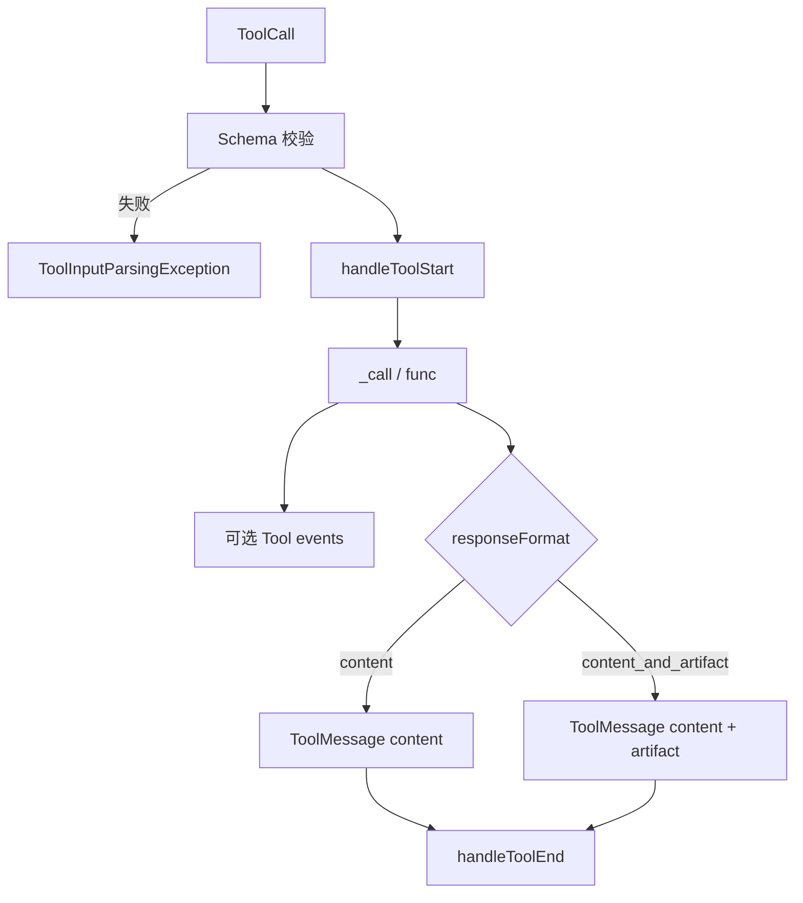
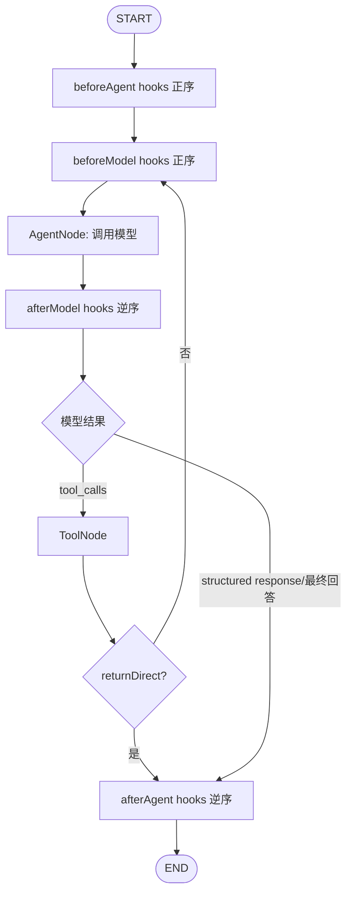
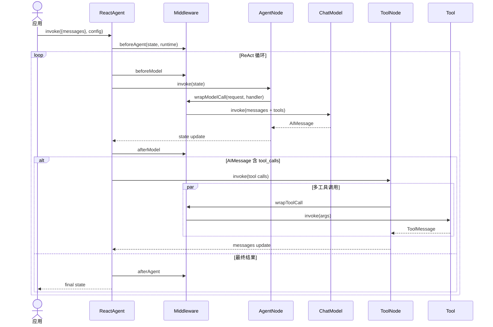

# 04. 工具、Agent 与中间件

## 新旧 Agent 边界

- 新入口：`langchain` 的 [`createAgent`](../../libs/langchain/src/agents/index.ts)，返回 [`ReactAgent`](../../libs/langchain/src/agents/ReactAgent.ts)。
- 旧入口：`@langchain/classic` 的 `AgentExecutor`，见 [Classic 章节](06-storage-memory-classic.md)。
- 新版 `ReactAgent` 不是简单 while 循环；它把模型、工具与中间件编译为 LangGraph `StateGraph`。

## Tool 协议

[`StructuredTool`](../../libs/langchain-core/src/tools/index.ts) 负责：

1. 使用 Zod/Standard JSON Schema 校验输入。
2. 创建 tool callback run。
3. 调用 `_call()`，消费可选异步生成器事件。
4. 按 `responseFormat` 生成 content，或 `[content, artifact]`。
5. 当输入是标准 `ToolCall` 时返回带 `tool_call_id` 的 `ToolMessage`。

`tool(func, fields)` 是首选工厂：字符串 schema 生成 `DynamicTool`，对象 schema 生成 `DynamicStructuredTool`。`returnDirect` 表示工具完成后 Agent 可直接退出循环。

## createAgent 做了什么

`createAgent()` 的实现本身只做 `new ReactAgent(params)`；真正的逻辑在构造器：

1. 合并显式 tools 和 middleware 提供的 tools。
2. 合并基础 state schema、用户 state schema 与 middleware state schema。
3. 创建 `AgentNode`，负责准备 model request 与调用模型。
4. 为 middleware hook 创建 before/after 节点。
5. 有 client tool 或 `wrapToolCall` 时创建 `ToolNode`。
6. 添加条件边，处理 tool calls、structured response、`returnDirect` 和 `jumpTo`。
7. 注册内建/中间件/用户 stream transformers，编译图。

## Agent 状态图

没有某类 hook 时对应节点被省略。`beforeAgent`/`afterAgent` 每次 invoke 只经过一次；`beforeModel`/`afterModel` 位于工具循环内部。Hook 可通过受约束的 `jumpTo` 改写下一跳。

## 完整时序

## 核心节点

| 类 | 路径 | 职责 |
| --- | --- | --- |
| `ReactAgent` | [`ReactAgent.ts`](../../libs/langchain/src/agents/ReactAgent.ts) | 构图、编译、invoke/stream、默认配置 |
| `AgentNode` | [`nodes/AgentNode.ts`](../../libs/langchain/src/agents/nodes/AgentNode.ts) | 构造 ModelRequest、绑定工具、执行模型和结构化输出 |
| `ToolNode` | [`nodes/ToolNode.ts`](../../libs/langchain/src/agents/nodes/ToolNode.ts) | 路由工具名、并行执行、错误与 Command 处理 |
| `Before/After*Node` | `agents/nodes` | 把 middleware hook 适配为图节点 |
| `createAgentState` | [`annotation.ts`](../../libs/langchain/src/agents/annotation.ts) | 合并 state/input/output schema |
| `RunnableCallable` | [`RunnableCallable.ts`](../../libs/langchain/src/agents/RunnableCallable.ts) | 将节点函数包装成 LangGraph 可运行对象 |

## 中间件生命周期

中间件由 [`createMiddleware`](../../libs/langchain/src/agents/middleware.ts) 创建，可声明 state/context schema、tools、stream transformers，以及以下 hook：

- `beforeAgent` / `afterAgent`
- `beforeModel` / `afterModel`
- `wrapModelCall(request, handler)`
- `wrapToolCall(request, handler)`

内建中间件：

| 类别 | 工厂 |
| --- | --- |
| 可靠性 | `modelRetryMiddleware`、`modelFallbackMiddleware`、`toolRetryMiddleware`、`toolErrorMiddleware` |
| 限流 | `modelCallLimitMiddleware`、`toolCallLimitMiddleware` |
| 上下文 | `summarizationMiddleware`、`contextEditingMiddleware`、`dynamicSystemPromptMiddleware` |
| 安全/审批 | `humanInTheLoopMiddleware`、`piiMiddleware`、`piiRedactionMiddleware`、`openAIModerationMiddleware` |
| 工具治理 | `llmToolSelectorMiddleware`、`providerToolSearchMiddleware`、`toolEmulatorMiddleware` |
| 工作规划 | `todoListMiddleware` |
| Provider 优化 | Anthropic/AWS prompt caching middleware |

## 结构化输出

[`responses.ts`](../../libs/langchain/src/agents/responses.ts) 提供两类策略：

- `ProviderStrategy`：使用模型原生 structured output。
- `ToolStrategy`：把 schema 暴露为特殊工具调用，从 tool call 中提取结果。

`createAgent` 的多个 TypeScript overload 用于保留 Zod、JSON Schema、SerializableSchema、数组 union 和 middleware state 的静态类型；运行时最终仍进入同一 `ReactAgent` 构造器。

## Streaming

`invoke()` 委托给编译后的 graph；`stream()` 保留 LangGraph stream mode。`streamEvents({version: "v3"})` 返回 `AgentRunStream`，提供：

- `messages`：消息生命周期和 text/reasoning 投影。
- `toolCalls`：工具名、输入、输出、状态。
- `middleware`：hook 生命周期。
- `values` / `output`：状态快照与最终状态。
- `subgraphs` / `extensions`：子 Agent 与自定义 transformer 投影。

## 扩展注意事项

- 中间件名称必须唯一，否则构图直接失败。
- `beforeAgent` 不应放入每轮模型调用逻辑；需要逐轮执行时用 `beforeModel`。
- 动态工具必须与 `wrapToolCall`/模型绑定保持一致，否则模型可能生成无法路由的工具名。
- Tool 错误是否转为 `ToolMessage` 由 ToolNode/中间件策略决定；不要吞掉未知异常。
- 需要持久线程状态时向 graph config 传 checkpointer 相关配置；Agent 类本身不把进程内状态当持久内存。

