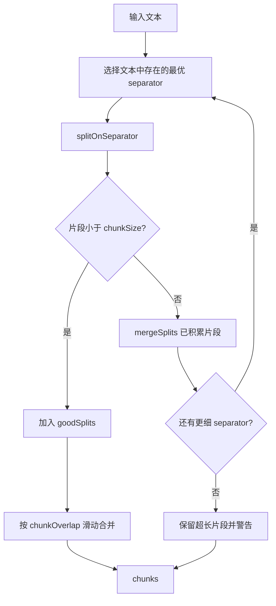
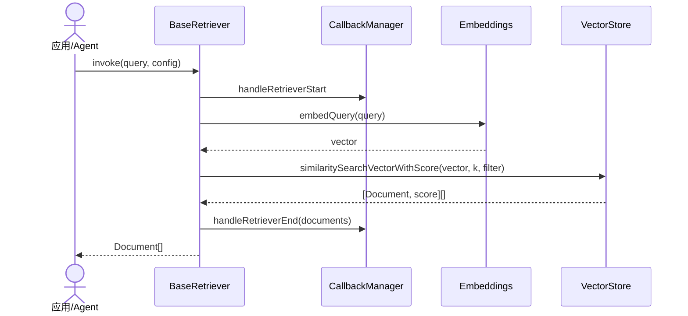
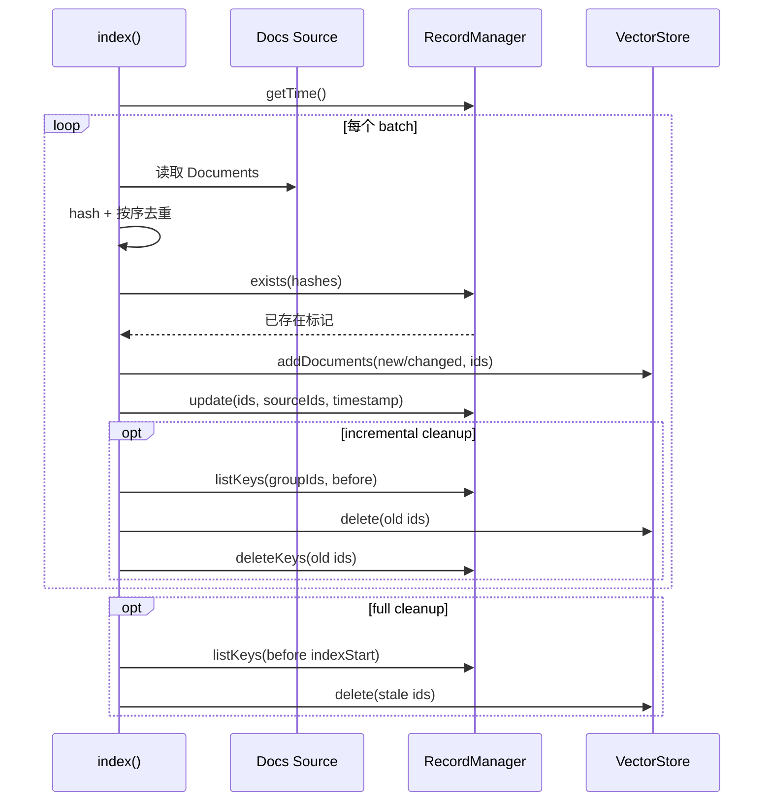

# 05. 文档、文本切分、索引与检索

## 模块职责

RAG 数据链路横跨 Core、`@langchain/textsplitters`、Classic 高级 Retriever 与 provider VectorStore。稳定契约位于 Core，具体存储位于独立 provider 包。

## 数据摄取流程

```mermaid
flowchart LR
    Source[文件/API/数据库] --> Loader[DocumentLoader]
    Loader --> Docs[Document pageContent + metadata]
    Docs --> Splitter[TextSplitter]
    Splitter --> Chunks[带 loc.lines 的 chunks]
    Chunks --> Index[index()]
    Index --> Embed[Embeddings.embedDocuments]
    Embed --> VS[VectorStore.addVectors/Documents]
    Index --> RM[RecordManager hashes/timestamps]
    Query[用户问题] --> Retriever[BaseRetriever]
    Retriever --> QE[Embeddings.embedQuery]
    QE --> VS
    VS --> Relevant[相关 Documents]
    Relevant --> Prompt[上下文 Prompt]
```

## Document 与 Loader

[`Document`](../../libs/langchain-core/src/documents/document.ts) 是最小数据单元：

- `pageContent`：字符串正文。
- `metadata`：来源、页码、权限、过滤字段等。
- 可选 `id`：外部稳定标识。

`BaseDocumentLoader` 定义 `load()`；Core 只保留基础 loader，文件系统和大量旧式 loader 位于 Classic，外部服务 loader 通常在 provider 包。

## TextSplitter

[`TextSplitter`](../../libs/langchain-textsplitters/src/text_splitter.ts) 继承 `BaseDocumentTransformer`。构造器保证 `chunkOverlap < chunkSize`，`createDocuments()` 将切分结果重新包装为 Document，并维护 `metadata.loc.lines`。

| 类 | 算法 |
| --- | --- |
| `CharacterTextSplitter` | 按单一 separator 切分后滑动合并 |
| `RecursiveCharacterTextSplitter` | 按多级 separator 递归切分过长片段 |
| `TokenTextSplitter` | 用 tokenizer 控制 chunk 大小 |
| `MarkdownTextSplitter` | 使用 Markdown 结构分隔符 |
| `LatexTextSplitter` | 使用 LaTeX 结构分隔符 |

### 递归切分流程



## Embeddings 与 VectorStore

[`Embeddings`](../../libs/langchain-core/src/embeddings.ts) 规定 `embedDocuments(texts)` 与 `embedQuery(text)`。[`VectorStore`](../../libs/langchain-core/src/vectorstores.ts) 持有 Embeddings，并规定：

- `addVectors` / `addDocuments`
- `similaritySearchVectorWithScore`
- `similaritySearch` / `similaritySearchWithScore`
- 可选 `delete` / `maxMarginalRelevanceSearch`
- `asRetriever()` 将 store 包装成 `VectorStoreRetriever`

`VectorStoreRetriever` 支持 similarity 与 MMR；MMR 模式会检查底层 store 是否真正实现该能力。

## BaseRetriever

[`BaseRetriever`](../../libs/langchain-core/src/retrievers/index.ts) 是 `Runnable<string, Document[]>`。子类实现 `_getRelevantDocuments(query, runManager)`；公开 `invoke()` 负责配置 callbacks，发出 retriever start/end/error。



## 增量索引

[`index()`](../../libs/langchain-core/src/indexing/base.ts) 协调 `docsSource`、`RecordManager` 和 VectorStore：

1. 将文档包装成带内容哈希的 `_HashedDocument`。
2. 按批次去重，向 RecordManager 查询已存在哈希。
3. 跳过未变化文档，或在 `forceUpdate` 时重写。
4. 将新增/变更文档写入 VectorStore，再更新记录时间与 source ID。
5. `incremental` 清理按 source 删除旧版本；`full` 清理删除本轮开始前未更新的记录。



## Classic 高级 Retriever

Core 只定义协议与文档压缩接口；高级策略位于 `@langchain/classic`：

| 实现 | 作用 |
| --- | --- |
| `MultiQueryRetriever` | 用模型生成多条查询并合并去重 |
| `ContextualCompressionRetriever` | 检索后压缩文档 |
| `ParentDocumentRetriever` | 检索小 chunk，返回父文档 |
| `SelfQueryRetriever` | 将自然语言转换为 query + metadata filter |
| `EnsembleRetriever` | 对多个 Retriever 做加权 reciprocal rank fusion |
| `ScoreThresholdRetriever` | 逐步扩大 k，直到阈值/上限 |
| `TimeWeightedVectorStoreRetriever` | 将语义相关度与时间衰减结合 |

## 设计与运维注意事项

- `chunkSize` 的计量单位由 `lengthFunction` 决定，字符和 token 不能混用。
- metadata filter 是 VectorStore 特定类型；跨 provider 切换时必须检查语义差异。
- `incremental` cleanup 必须提供 `sourceIdKey`，否则无法界定同一来源的旧版本。
- 写入 VectorStore 成功后再更新 RecordManager，避免记录存在但向量缺失。
- Retriever 的 callbacks 应使用 `runManager.getChild("vectorstore")` 继续传播。

