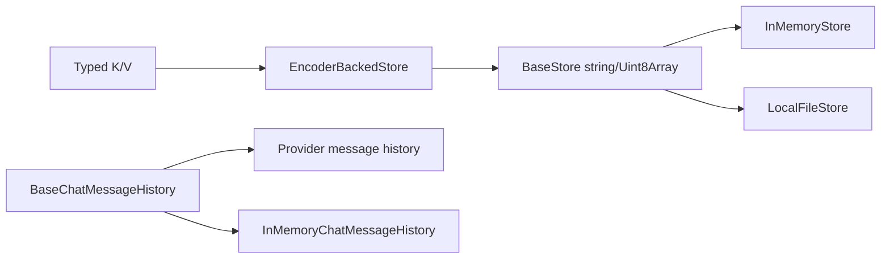
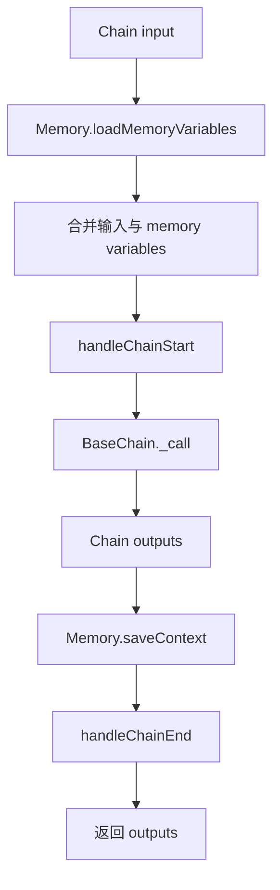
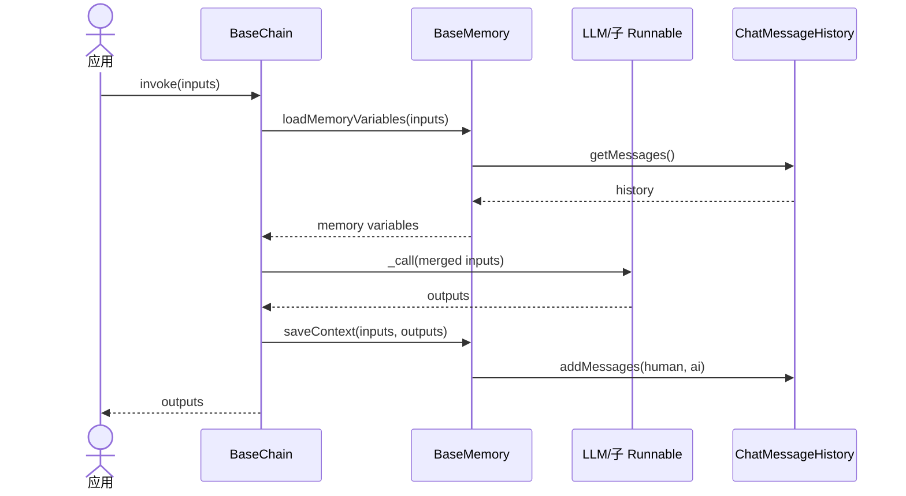
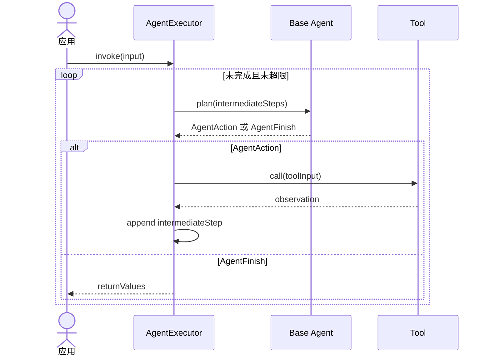

# 06. Store、Memory 与 Classic 兼容层

## 模块边界

当前仓库有两套容易混淆的状态概念：

- **Core Store/ChatHistory**：低层持久化协议，不负责 Agent 编排。
- **现代 Agent state**：由 LangGraph state、checkpointer 和 store 管理。
- **Classic Memory**：在旧式 Chain 调用前加载变量、调用后保存上下文。

新项目不应仅因为需要对话记忆就引入 `@langchain/classic`；现代 Agent 应优先使用 LangGraph 的线程状态与持久化能力。

## Core Store

[`BaseStore<K,V>`](../../libs/langchain-core/src/stores.ts) 定义批量协议：

- `mget(keys)`：批量读取。
- `mset([key,value][])`：批量写入。
- `mdelete(keys)`：批量删除。
- `yieldKeys(prefix?)`：异步枚举键。

`InMemoryStore` 是 Map 驱动的进程内实现。主包另提供 [`LocalFileStore`](../../libs/langchain/src/storage/file_system.ts) 和 [`EncoderBackedStore`](../../libs/langchain/src/storage/encoder_backed.ts)，后者用 key/value encoder 把强类型 Store 映射到底层字节 Store。

[`BaseChatMessageHistory`](../../libs/langchain-core/src/chat_history.ts) 定义消息历史接口，`BaseListChatMessageHistory` 提供逐条/批量默认实现，`InMemoryChatMessageHistory` 用数组保存消息。

## Classic 包定位

`@langchain/classic` 当前约有 440 个 TypeScript 文件、95 个导出入口。它保存旧版 API 和仍有价值的高级组件：

| 区域 | 责任 |
| --- | --- |
| `chains` | LLMChain、顺序链、路由、RAG、SQL、文档组合 |
| `agents` | 旧 Agent 类型、输出解析器、`AgentExecutor` |
| `memory` | Buffer、Window、Token、Summary、Entity、VectorStore memory |
| `retrievers` | MultiQuery、SelfQuery、ParentDocument 等高级策略 |
| `document_loaders` | 本地文件与目录 loader |
| `evaluation` / `smith` | 传统评估与 LangSmith 辅助 |
| `experimental` | AutoGPT、BabyAGI、generative agents 等非稳定实现 |

## BaseChain 调用模型

[`BaseChain`](../../libs/langchain-classic/src/chains/base.ts) 也是 Runnable，但使用 `inputKeys`、`outputKeys` 和 `_call()` 表达传统 chain。配置的 Memory 在执行前后介入。

### Chain + Memory 时序

## 典型 Chain

| 类/函数 | 责任 |
| --- | --- |
| `LLMChain` | Prompt -> LLM -> output parser 的传统封装 |
| `SequentialChain` | 按 input/output key 串联多个 Chain |
| `ConversationChain` | LLMChain + conversation memory |
| `createRetrievalChain` | Retriever 与文档回答 Runnable 组合 |
| `createStuffDocumentsChain` | 把多个 Document 格式化后一次送给模型 |
| `MapReduceDocumentsChain` | 分块 map，再 reduce/collapse |
| `ConversationalRetrievalQAChain` | 结合聊天历史改写问题并检索 |
| `SqlDatabaseChain` | 生成、执行和解释 SQL；需要严格权限控制 |

## Classic AgentExecutor

[`AgentExecutor`](../../libs/langchain-classic/src/agents/executor.ts) 运行旧式 AgentAction 循环：Agent 规划下一步，Executor 查找工具、执行并追加 observation，直到得到 AgentFinish 或达到迭代/时间上限。`AgentExecutorIterator` 支持逐步输出。

## Classic Memory 实现

| 类 | 行为与代价 |
| --- | --- |
| `BufferMemory` | 保留全部对话，简单但上下文持续增长 |
| `BufferWindowMemory` | 只保留最近 k 轮 |
| `ConversationTokenBufferMemory` | 按 token 上限裁剪，需要模型计数 |
| `ConversationSummaryMemory` | 持续用模型维护摘要，增加模型调用 |
| `ConversationSummaryBufferMemory` | 摘要旧消息、保留近期原文 |
| `EntityMemory` | 提取并维护实体状态 |
| `VectorStoreRetrieverMemory` | 将历史写入 VectorStore，按查询召回 |
| `CombinedMemory` | 合并多个 memory，需避免 key 冲突 |

## 迁移建议

- `LLMChain` 的简单管道迁移为 `prompt.pipe(model).pipe(parser)`。
- `AgentExecutor` 迁移为 `createAgent`，重试、审批、摘要改为 middleware。
- Buffer memory 迁移为 LangGraph messages state + checkpointer；长期知识迁移到 Store/VectorStore。
- Classic 高级 Retriever 可继续作为 `BaseRetriever` 使用，不要求一次性重写。
- `experimental` 目录不应作为稳定公共契约，升级前必须核对实现与测试。

