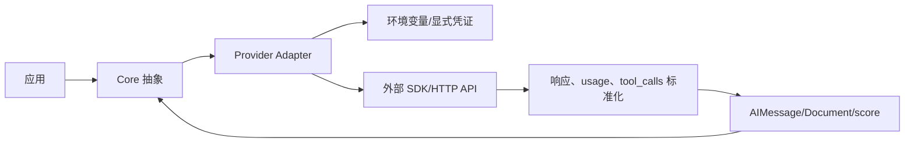
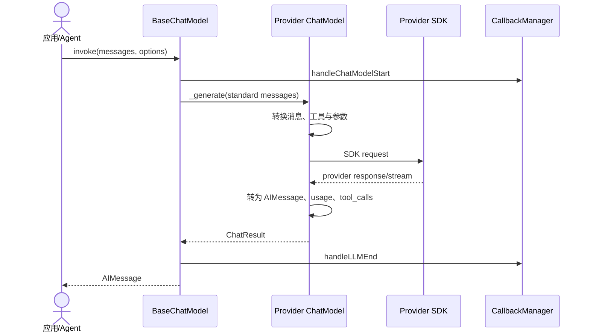
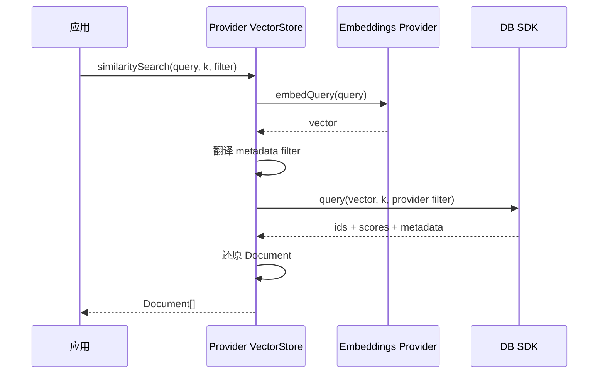

# 07. Provider 集成层

## 统一适配模式

Provider 包把外部 SDK 的构造参数、请求、流、错误与响应映射到 `@langchain/core`。它们独立发布，通常把 Core 声明为 peer dependency。

## 模型 provider 时序

## Provider 能力矩阵

“入口能力”来自当前 `src` 结构；具体模型和服务端功能仍受对应 SDK 与账号限制。

| 包 | 主要能力 |
| --- | --- |
| `@langchain/anthropic` | Chat、tool calling、structured output、profile、output parser |
| `@langchain/aws` | Bedrock Converse Chat、Bedrock Embeddings |
| `@langchain/cloudflare` | Chat/LLM、Embeddings、Vectorize、Cache、MessageHistory |
| `@langchain/cohere` | Chat/LLM、Embeddings、Rerank |
| `@langchain/deepseek` | OpenAI 兼容 Chat、profile |
| `@langchain/exa` | Search Tool 与 Retriever |
| `@langchain/fireworks` | OpenAI 兼容 Chat/LLM、Embeddings |
| `@langchain/google` | Google 集成聚合入口 |
| `@langchain/google-common` | Google 公共 auth、connection、Chat/LLM/Embeddings、类型与 parser |
| `@langchain/google-gauth` | Node Google Auth、media、Chat/LLM/Embeddings |
| `@langchain/google-genai` | Gemini Chat、Embeddings、profile、parser |
| `@langchain/google-vertexai` | Node Vertex AI Chat/LLM/Embeddings |
| `@langchain/google-vertexai-web` | Web auth 的 Vertex AI Chat/LLM/Embeddings |
| `@langchain/google-webauth` | 浏览器 Google auth、media 与公共实现 |
| `@langchain/groq` | Chat、tool calling、profile |
| `@langchain/ibm` | IBM watsonx 集成与类型 |
| `@langchain/mistralai` | Chat/LLM、Embeddings |
| `@langchain/mongodb` | Atlas Vector Search、Cache、ChatHistory、Storage、Voyage 辅助 |
| `@langchain/neo4j` | Neo4j VectorStore/Graph 相关集成 |
| `@langchain/ollama` | 本地 Chat/LLM、Embeddings |
| `@langchain/openai` | `ChatOpenAI`、`AzureChatOpenAI`、OpenAI LLM、Embeddings |
| `@langchain/openrouter` | OpenAI 兼容模型、API 类型、profile |
| `@langchain/perplexity` | Chat、Search Tool 与 Retriever |
| `@langchain/pgvector` | PostgreSQL pgvector Store |
| `@langchain/pinecone` | Pinecone Store、Embeddings、filter translator |
| `@langchain/qdrant` | Qdrant VectorStore |
| `@langchain/redis` | VectorStore、fluent query、Cache、ChatHistory、连接与 schema |
| `@langchain/tavily` | Search、Extract、Crawl、Map、Research 工具 |
| `@langchain/together-ai` | OpenAI 兼容 Chat/LLM、Embeddings |
| `@langchain/weaviate` | Weaviate VectorStore 与 filter translator |
| `@langchain/xai` | xAI/Grok、live search、profile |

## 关键实现示例

| 类 | 源码 | 对应 Core 抽象 |
| --- | --- | --- |
| `ChatOpenAI` | [`langchain-openai/src/chat_models/index.ts`](../../libs/providers/langchain-openai/src/chat_models/index.ts) | `BaseChatModel` |
| `AzureChatOpenAI` | [`langchain-openai/src/azure/chat_models/index.ts`](../../libs/providers/langchain-openai/src/azure/chat_models/index.ts) | `ChatOpenAI` 变体 |
| `ChatAnthropic` | [`langchain-anthropic/src/chat_models.ts`](../../libs/providers/langchain-anthropic/src/chat_models.ts) | `BaseChatModel` |
| `ChatBedrockConverse` | [`langchain-aws/src/chat_models.ts`](../../libs/providers/langchain-aws/src/chat_models.ts) | `BaseChatModel` |
| `ChatGoogleGenerativeAI` | [`langchain-google-genai/src/chat_models.ts`](../../libs/providers/langchain-google-genai/src/chat_models.ts) | Google 公共 Chat 基类 |
| `OpenAIEmbeddings` | [`langchain-openai/src/embeddings.ts`](../../libs/providers/langchain-openai/src/embeddings.ts) | `Embeddings` |
| `PineconeStore` | [`langchain-pinecone/src/vectorstores.ts`](../../libs/providers/langchain-pinecone/src/vectorstores.ts) | `VectorStore` |
| `RedisVectorStore` | [`langchain-redis/src/vectorstores.ts`](../../libs/providers/langchain-redis/src/vectorstores.ts) | `VectorStore` |

## VectorStore provider 时序

## 依赖模式

- 多数包直接实现 Core 抽象。
- DeepSeek、Fireworks、OpenRouter、Together AI、xAI 等复用 `@langchain/openai` 的兼容协议。
- Google 系列进一步拆分 common、Node auth、Web auth 与具体 API，避免浏览器包引入 Node-only 依赖。
- 数据库 provider 可能只实现 VectorStore/Cache/History，不应假设一定有 ChatModel。

## 新增集成

使用 [`create-langchain-integration`](../../libs/create-langchain-integration) 生成包骨架，然后：

1. 把 `@langchain/core` 声明为 peer dependency 和 workspace dev dependency。
2. 实现对应抽象及序列化 namespace/secrets。
3. 增加 unit、integration、type 和 standard tests。
4. 在 `src/index.ts` 只导出稳定公共 API。
5. 验证 Node ESM/CJS 以及目标 edge/browser 环境。

## 常见风险

- provider SDK 错误必须保留 cause 与可诊断信息，认证/限流/中止不能混为普通模型输出。
- tool schema、content blocks、finish reason 与 usage 是兼容最容易出错的四处。
- 浏览器/Edge 包不能静态导入 `fs`、`child_process` 等 Node 模块。
- 环境变量通过 Core `getEnvironmentVariable()` 读取；不要在普通源码直接访问 `process.env`。
- integration tests 会产生真实调用和费用，单测应使用 mock/fake model。

