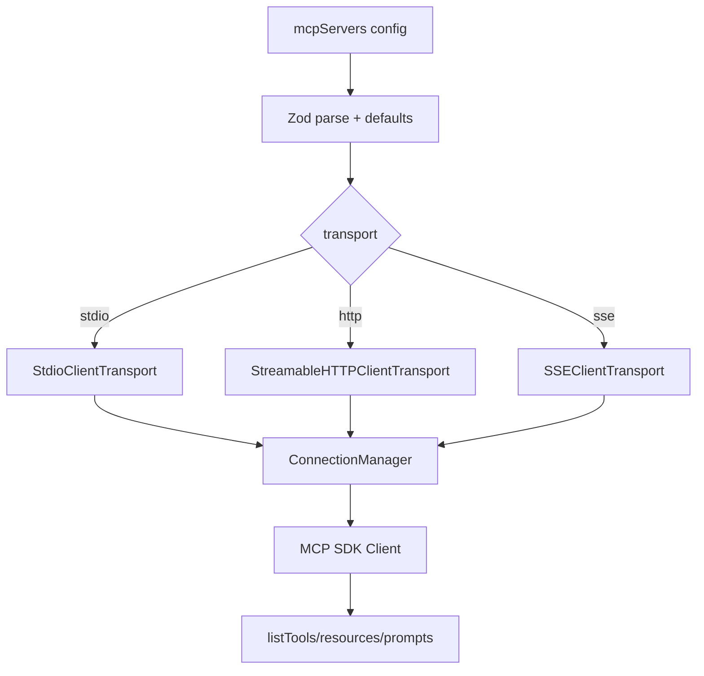
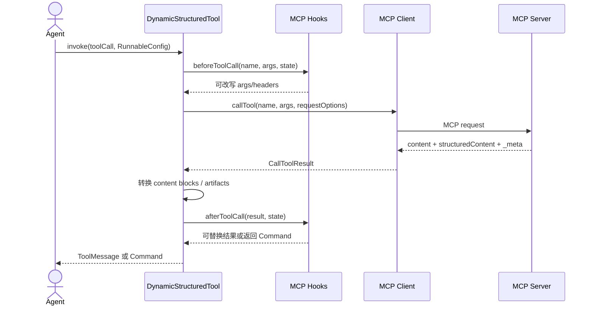
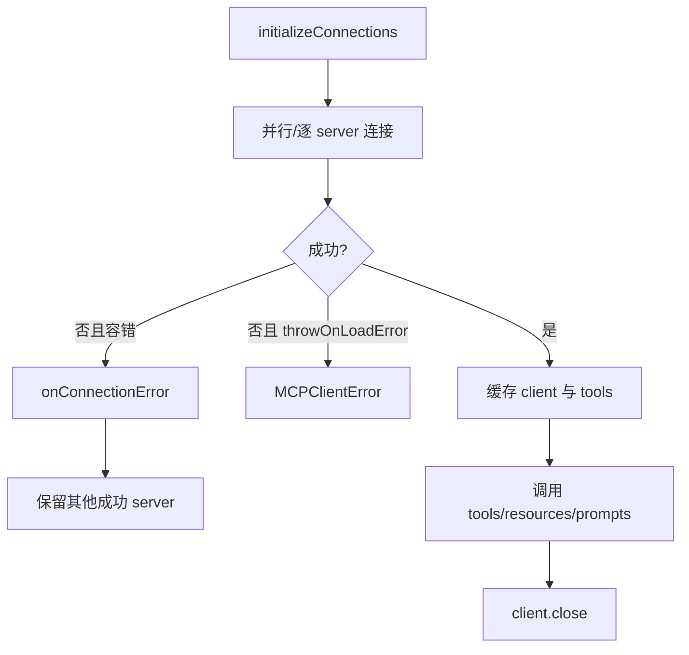

# 08. MCP 适配器

## 目标

`@langchain/mcp-adapters` 把一个或多个 Model Context Protocol Server 暴露的 tools、resources、resource templates 和 prompts 接入 LangChain。核心入口是 [`MultiServerMCPClient`](../../libs/langchain-mcp-adapters/src/client.ts) 与 [`loadMcpTools`](../../libs/langchain-mcp-adapters/src/tools.ts)。

## 组成

| 文件/类 | 职责 |
| --- | --- |
| `types.ts` | Zod 配置、transport、资源/Prompt/Hook 类型 |
| `ConnectionManager` | 连接池、transport 创建、fork、关闭和查询 |
| `MultiServerMCPClient` | 多 server 初始化、工具/资源/Prompt 聚合 |
| `loadMcpTools` | MCP Tool -> `DynamicStructuredTool` |
| `hooks.ts` | connection、progress、before/after tool call hooks |
| `ToolException` | 将 MCP/校验错误标记为工具级错误 |

## Transport

支持：

- `stdio`：`command`、`args`、`env`、`cwd`，可配置进程 restart。
- `http`：Streamable HTTP，支持 headers、OAuth provider 与 reconnect。
- `sse`：显式旧 SSE transport，支持 headers/OAuth。

未显式提供 transport 时可按配置结构推断。HTTP 连接可通过 `fork(headers)` 派生临时 client；stdio 不支持 fork。

## 工具发现与转换

`loadMcpTools()` 会翻页调用 `client.listTools()`，然后对每个工具：

1. 补齐缺失的 `inputSchema.properties`。
2. 展开 `$defs/$ref`。
3. 简化 LLM 不兼容的 `allOf/anyOf/oneOf` 等结构。
4. 按配置添加 server/name prefix。
5. 创建 `DynamicStructuredTool`，响应格式固定为 `content_and_artifact`。
6. 在 `func` 中调用 MCP `callTool()`，传播 timeout、AbortSignal 与 progress。

## 结果映射

MCP result 的处理规则：

| MCP 内容 | LangChain 映射 |
| --- | --- |
| `text` | string 或标准 text block |
| `image` | base64 standard image block，或兼容 `image_url` |
| `audio` | standard audio block |
| `resource_link` | URL file block |
| embedded `resource` | 默认 artifact；需要时调用 `readResource` 展开 |
| `structuredContent` | `mcp_structured_content` artifact |
| `_meta` | `mcp_meta` artifact |

`outputHandling` 可把不同内容类型定向到 content 或 artifact。`isError`、非法 content 数组、未知 block 类型和 Zod 校验错误都会转成 `ToolException`。

## MultiServerMCPClient

主要方法：

- `getTools(...servers)`：延迟初始化连接并返回扁平 Tool 数组。
- `getClient(serverName)`：获得底层 SDK Client。
- `listResources` / `listResourceTemplates` / `readResource`：资源访问。
- `listPrompts` / `getPrompt`：Prompt 访问。
- `setLoggingLevel`：单 server 或全部 server 日志级别。
- `close()`：关闭连接池，stdio 子进程也应随之释放。

## 错误与生命周期

## 安全注意事项

- stdio 的 `command` 等价于启动本地进程，配置必须来自可信源。
- headers、OAuth token 与环境变量不可写入日志或序列化文档。
- `beforeToolCall` 修改 headers 时会 fork HTTP client；不要用于 stdio。
- 对远程工具设置 `defaultToolTimeout`，并向调用传递 `signal`。
- MCP schema 简化会损失一部分约束，服务端仍必须做最终输入校验。

