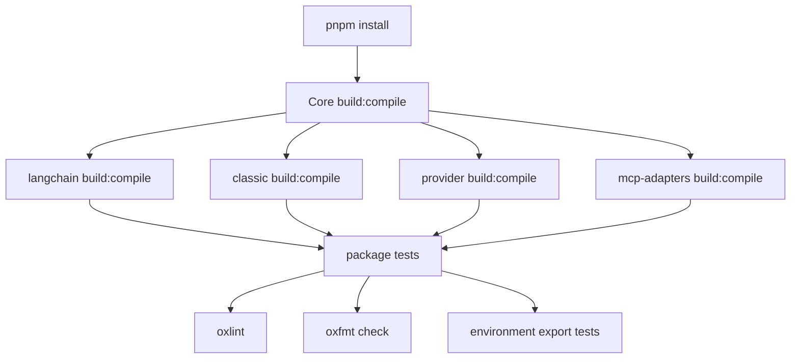
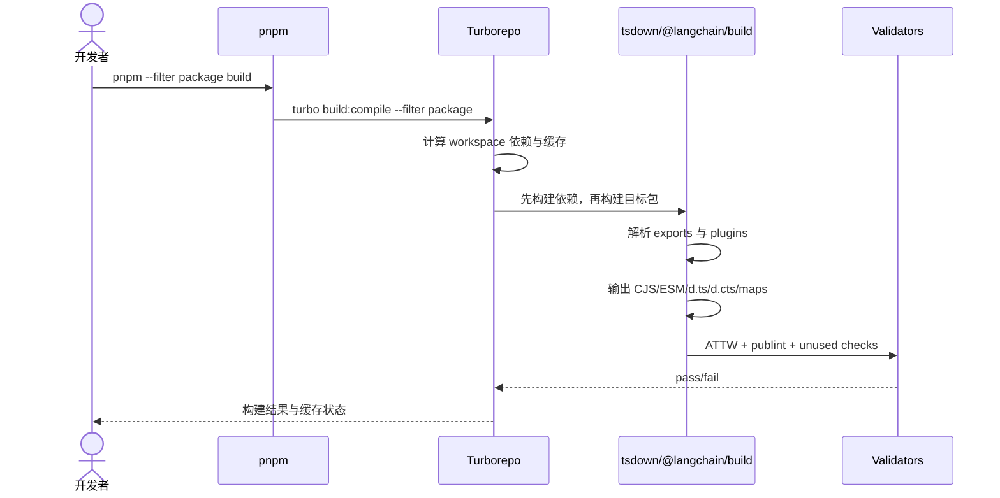
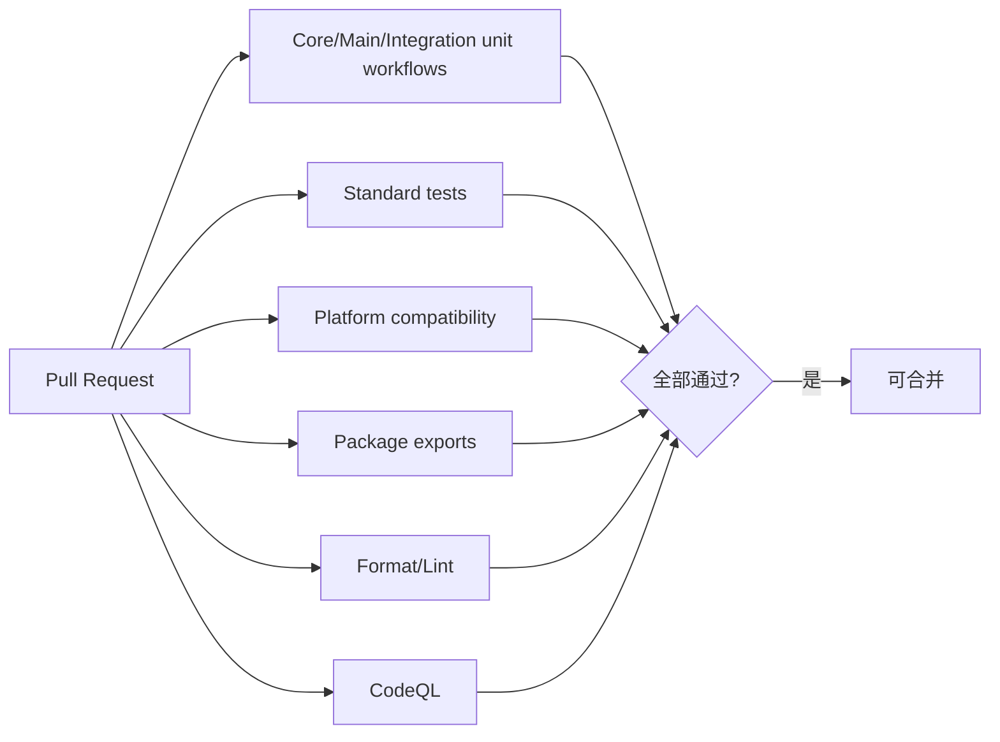

# 09. 安装、构建、测试与发布

## 环境要求

| 工具 | 当前仓库要求 |
| --- | --- |
| Node.js | `.nvmrc` 为 `v24.6.0`；支持环境为 Node 20/22/24，开发建议 24 |
| pnpm | 根 `packageManager` 为 `pnpm@10.14.0` |
| Docker | 仅导出兼容测试和依赖范围测试需要 |
| 外部凭证 | 仅 provider integration tests 需要 |

工作目录为官方源码根：

```powershell
git clone --depth 1 https://github.com/langchain-ai/langchainjs.git
cd D:\langchainjs\official-langchainjs
node --version
pnpm --version
pnpm install --frozen-lockfile
pnpm --filter @langchain/core build
```

首次只阅读源码无需安装依赖；构建、类型生成和测试才需要安装。

## “运行项目”的含义

该仓库发布的是库，不是带统一端口的 Web 服务，因此根目录没有 `start` 命令。验证源码运行状态通常是“安装 -> 构建目标包 -> 运行该包测试”；实际 LangChain 应用则在独立项目中安装发布包：

```powershell
pnpm add langchain @langchain/openai zod
```

```ts
import { createAgent } from "langchain";

const agent = createAgent({
  model: "openai:gpt-4.1-mini",
  tools: [],
});

const result = await agent.invoke({
  messages: [{ role: "user", content: "Hello" }],
});

console.log(result.messages.at(-1)?.content);
```

运行该示例需要设置 provider 对应的 API key。若直接调试仓库源码，优先运行相关 Vitest 文件，而不是在源码包中临时增加入口脚本。

## 工作区任务图

[`turbo.json`](../../turbo.json) 规定 `build:compile` 依赖上游包的 `^build:compile`。因此构建 provider 或主包时，Turbo 会先构建它依赖的 workspace 包。



## 常用命令

### 构建

```powershell
# 全工作区
pnpm build

# 指定包
pnpm --filter @langchain/core build
pnpm --filter langchain build
pnpm --filter @langchain/openai build

# 开发监听
pnpm watch
```

### 代码质量

```powershell
pnpm lint
pnpm format:check

# 只有确定要改写格式时
pnpm format
```

### 测试

```powershell
# 指定包单测
pnpm --filter @langchain/core test
pnpm --filter langchain test
pnpm --filter @langchain/openai test

# 根级非导出单测
pnpm test:unit

# 指定测试文件
pnpm --filter @langchain/core test:single src/messages/tests/utils.test.ts

# 需要真实凭证的集成测试
pnpm --filter langchain test:integration

# Docker 环境导出测试
pnpm test:exports:docker

# 根完整测试 = unit + Docker exports
pnpm test
```

`test:single` 是否存在取决于包脚本/Turbo task；若包没有脚本，使用 `pnpm --filter <pkg> exec vitest run <path>`。

## 构建系统

[`@langchain/build`](../../internal/build) 基于 `tsdown`，默认：

- CJS + ESM 双格式。
- ES2022、Node platform。
- `.d.ts` 与 `.d.cts` 类型声明。
- source map。
- unbundle 模式，依赖保持外部 import。
- ATTW、publint 与 unused dependency 验证。

各包 `tsdown.config.ts` 从 `package.json.exports` 对应的源码入口构建。主要插件：

| 插件 | 作用 |
| --- | --- |
| `cjsCompatPlugin` | 生成 CJS/ESM 与声明兼容 barrel |
| `lcSecretsPlugin` | 扫描 `lc_secrets`，生成 SecretMap 并校验名称 |
| `importMapPlugin` | 为动态加载生成命名空间 import map |
| `importConstantsPlugin` | 生成可选入口清单 |

### 单包构建时序



## 测试层级

| 文件/目录 | 目标 |
| --- | --- |
| `*.test.ts` | 无外部 API 的 unit tests |
| `*.int.test.ts` | 真实服务 integration tests |
| `*.test-d.ts` | `expectTypeOf` 驱动的类型推断验证 |
| `*.standard.test.ts` | provider 标准行为单测 |
| `*.standard.int.test.ts` | provider 标准集成行为 |
| `environment_tests` | ESM/CJS/Cloudflare/Bun/Vite/Vercel/tsc 与 Zod 兼容 |
| `dependency_range_tests` | 支持依赖版本范围 |

`internal/standard-tests` 为 ChatModel 等集成定义可复用测试基类。新增 provider 功能时应声明 capabilities，并让标准测试验证 invoke、stream、tool calling、structured output 和 usage 等一致性。

## CI 流程



## 环境变量与凭证

- 从包内 `.env.example` 复制所需变量到本地 `.env`，不要提交。
- integration test 只设置其需要的 API key，避免意外调用多个 provider。
- 源码使用 `getEnvironmentVariable()`，序列化对象用 `lc_secrets` 标记密钥。
- CI secret 与本地凭证不应进入 snapshot、callback metadata 或 debug log。

## 发布

仓库使用 Changesets。典型维护者流程：

```powershell
pnpm changeset
pnpm changeset:version
pnpm build
pnpm release
```

根脚本的 `release` 执行 `changeset publish`。实际发布还需要 npm 权限、CI 策略和仓库维护者授权。开发预览版通过 GitHub workflow 发布带 commit SHA 的 `dev` 版本。

## 常见故障

| 现象 | 排查 |
| --- | --- |
| 找不到 workspace 包产物 | 先构建 Core，确认 Turbo 依赖图和 `dist` |
| ESM/CJS 导入失败 | 检查 package exports，并运行 environment export tests |
| 类型与运行时导出不一致 | 检查 `.d.ts/.d.cts` 和 ATTW/publint 输出 |
| 集成测试认证失败 | 核对包内 `.env.example`、模型区域和 endpoint |
| Edge 构建引入 Node 模块 | 检查静态 import 与 browser export condition |
| 缓存导致结果疑似陈旧 | 用 `pnpm clean` 或针对包清理 `.turbo/dist` 后重建 |
