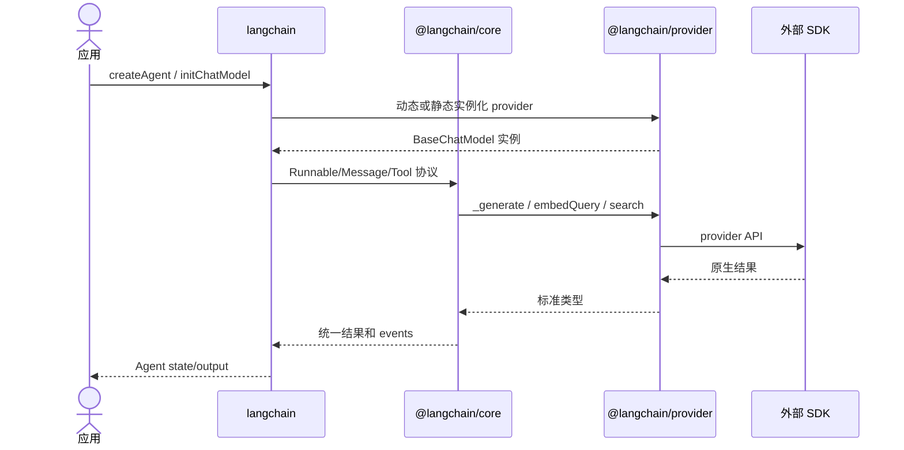

# 11. 包依赖关系与改动影响

## 工作区依赖主图

```mermaid
flowchart TD
    Core[@langchain/core]
    Main[langchain]
    Classic[@langchain/classic]
    Split[@langchain/textsplitters]
    MCP[@langchain/mcp-adapters]
    LG[@langchain/langgraph 外部包]
    OpenAI[@langchain/openai]
    Providers[大多数 provider]
    Compat[OpenAI-compatible providers]
    Data[Vector DB / Search providers]
    Build[@langchain/build]
    Std[@langchain/standard-tests]

    Main --> Core
    Main --> LG
    Classic --> Core
    Classic --> Split
    Classic --> OpenAI
    Split --> Core
    MCP --> Core
    MCP --> LG
    OpenAI --> Core
    Providers --> Core
    Compat --> OpenAI
    Compat --> Core
    Data --> Core
    Std --> Core
    Build -. 构建所有包 .-> Main
    Build -.-> Core
    Build -.-> Providers
```

箭头表示“源包依赖目标包”。Core 位于依赖图底部，不能反向导入主包、Classic 或 provider。

## 主要包清单

| 包 | 当前版本 | 公开入口数 | 直接 LangChain 依赖 |
| --- | ---: | ---: | --- |
| `@langchain/core` | 1.2.3 | 72 | 无 |
| `langchain` | 1.5.4 | 12 | Core、LangGraph、LangGraph checkpoint |
| `@langchain/classic` | 1.0.40 | 95 | Core、OpenAI、Textsplitters |
| `@langchain/textsplitters` | 1.0.1 | 2 | Core peer |
| `@langchain/mcp-adapters` | 1.1.3 | 2 | Core、LangGraph |
| `create-langchain-integration` | 0.0.12 | CLI | 工程依赖，无运行时 Core |

## Provider 依赖分组

### 直接依赖 Core

Anthropic、AWS、Cloudflare、Cohere、Exa、Google Common/GenAI/WebAuth、Groq、IBM、Mistral、MongoDB、Ollama、OpenAI、Perplexity、PGVector、Pinecone、Qdrant、Redis、Tavily、Weaviate 等直接实现 Core 抽象。

### 复用 OpenAI 协议

DeepSeek、Fireworks、OpenRouter、Together AI、xAI 等同时依赖 Core 与 `@langchain/openai`，复用兼容请求/消息实现。修改 OpenAI 内部可扩展基类时必须运行这些下游包测试。

### Google 子图

```mermaid
flowchart LR
    Common[@langchain/google-common] --> Core[@langchain/core]
    GAuth[@langchain/google-gauth] --> Common
    WebAuth[@langchain/google-webauth] --> Common
    Vertex[@langchain/google-vertexai] --> GAuth
    VertexWeb[@langchain/google-vertexai-web] --> WebAuth
    GenAI[@langchain/google-genai] --> Core
    Aggregate[@langchain/google] --> Core
```

## 运行时依赖时序



## 改动影响矩阵

| 修改区域 | 高风险下游 | 必须关注的验证 |
| --- | --- | --- |
| `core/runnables` | 所有主包、provider、Classic | Core 全测、主包 Agent、stream events、exports |
| `core/messages` | 所有 ChatModel provider | content blocks、tool calls、chunk concat、standard tests |
| `core/language_models` | 模型 provider | invoke/cache/stream/usage/abort |
| `core/tools` | Agent、MCP、provider tools | schema v3/v4、ToolMessage、artifact、errors |
| `langchain/agents` | 现代 Agent 用户 | graph routing、middleware order、stream v3、types |
| `langchain-classic` | 旧 API 用户 | 对应 export 单测与迁移兼容 |
| `langchain-openai` 基类 | OpenAI 兼容 provider | DeepSeek/Fireworks/OpenRouter/Together/xAI |
| Google Common/Auth | Vertex 与 Web 子包 | Node/browser 条件、auth、media |
| VectorStore Core | 所有数据库 provider | add/search/delete/MMR/filter 类型 |
| `internal/build` | 每个发布包 | 全构建、ATTW、publint、ESM/CJS export tests |

## 禁止的依赖方向

- Core 不得导入 `langchain` 或任何 provider。
- provider 不应依赖主 `langchain` 来获得 Core 类型。
- 浏览器入口不得导入 Node-only 实现。
- 现代主包不应重新依赖 Classic 以实现新功能。
- 公共包不应依赖 `internal/test-helpers` 等测试专用包。

## 维护依赖关系的方法

1. 以各 `package.json` 的 dependencies/peerDependencies 为事实来源。
2. 以 `package.json.exports` 与 `tsdown.config.ts entry` 双向核对公共入口。
3. 用 Turbo `^build:compile` 保证上游先构建。
4. 用 `lint:dpdm`（包支持时）检测循环依赖。
5. 用 environment tests 验证导出条件，而不只验证源码内部 import。
